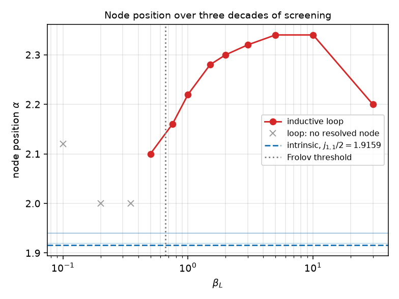

# Fractional Shapiro step discrimination

**Which electrical axes separate intrinsic from extrinsic fractional Shapiro
steps, and which do not**

Faruk Sami Bilgin (independent researcher) · Status: **Manuscript in preparation (short paper)** · [`paper/main.pdf`](paper/main.pdf)

## Question

Half-integer Shapiro steps are attributed either to a second harmonic in the
current-phase relation (intrinsic) or to trapped flux (extrinsic). Zhu, Wang,
Zhang & Xue (arXiv:2512.01586) observed fractional steps in twisted cuprate
junctions and assigned them to trapped vortices using tests that perturb the
sample (thermal cycling, field or current training). Which *purely electrical*
axes of a Shapiro map discriminate?

## Models, and what is reproduced

- Intrinsic: overdamped two-harmonic RSJ junction; short-junction Beenakker CPR
  (PRL 67, 3836 (1991)) at transparency 0.8 where a specific harmonic content
  is needed.
- Extrinsic: asymmetric inductive two-link loop with trapped flux, no harmonic
  put in by hand. This is the model of Frolov et al., PRB 74, 020503(R) (2006),
  solved perturbatively by Mori & Maekawa, Appl. Phys. Express 14, 103001 (2021).
- Reproduced: the intrinsic half-step node of Tsarev & Fominov (SciPost Phys. 19,
  148 (2025), Eq. 39): |J1(2α)| envelope with the node at α = j11/2 = 1.9159.
  The numerics give 1.94, 1.94, 1.92 for c2/c1 = −0.15, −0.25, −0.40, with node
  depths three orders of magnitude below the peak. This part is published and is
  not claimed as new.

## Results

- **Drive frequency does not discriminate.** Intrinsic: w½/w1 rises +56% to
  +102% from Ω = 2 to 8. Loop: +31% (β_L = 0.5), −61% (4), +279% (30), +647%
  (100). Only a one-sided exclusion survives (a rise below 56% excludes the
  intrinsic mechanism). These numbers come from an older grid-counting estimator
  and carry its ±10% systematic.
- **Initial conditions mostly do not**, with one unresolved exception
  (Ω = 5, β_L = 1: a 10% dependence on initial phase).
- **The drive node works, conditionally (new: the loop side).** Loop node vs
  screening parameter over three decades: the miss vs 1.9159 runs from +9.6%
  (β_L = 0.5) to +22.1% (β_L = 5–10) and then saturates, so it cannot be inverted
  to measure β_L. Below Frolov's existence threshold β_L = 0.659 the loop has no
  resolved half step. Usable statement: within β_L ∈ [0.66, 10], a node at
  1.92–1.94 is intrinsic and the loop misses it by 10–22%.
- **Trapped flux separates the two extrinsic channels.** At all nine settings
  (β_L ∈ {0.5, 2, 10}, Ω ∈ {2, 5, 8}) the loop's net half-step width peaks at
  f = 0.50–0.60 and is at the estimator floor at f = 0, whereas the
  alternating-j_c channel (Moshe & Mints, arXiv:0708.1222) has a finite half step
  at zero applied flux.
- **Thermal verdict withheld.** The control subtraction does not cancel (the two
  CPRs have different ohmic slopes at the transit): the residual is 1.5% of the
  half-step net width but 58.7% of the quarter-step one. An earlier claim that
  both thermal laws are excluded (19.4σ / 6.0σ) is retracted.



## Negative results and retractions

The draft's "parameter-free test" did not survive a wider β_L scan and is now a
bounded, conditional statement; the thermal "two published laws excluded" claim
is withdrawn (one of the two laws was an uncited estimate, and the systematic
above had been omitted). See `REFEREE.md`.

## Notes on the code

- `scripts/e4_floor_and_node.py` (node table and figure),
  `scripts/e5_floor_systematic.py` (subtraction residual),
  `scripts/e1_flux_sweep.py` (flux axis), `scripts/discriminator.py` and
  `scripts/verify.py` (frequency axis), `scripts/multistability.py`,
  `scripts/r23_alpha.py`, `scripts/e0b_drive_degeneracy.py`, and `scripts/e3*.py`
  (thermal runs whose verdict is withheld). Core solver: `scripts/shapiro.py`.
- The Beenakker CPR harmonics are vendored in `scripts/data/beenakker_cpr.json`
  (read via `scripts/cpr_data.py`); in the working tree they were read from a
  sibling project. Three scripts specific to that unrelated project were left out.
- `results/node_positions.json` and `results/loop_node_extension.json` are early
  artifacts without a producing script (flagged by the referee); the
  manuscript's node table comes from `results/floor_and_node.json`.

## Limitations

One caricature of the extrinsic mechanism; overdamped frame (finite capacitance
generates subharmonic steps even from a sinusoidal CPR); noiseless node and flux
scans; asymmetry fixed at a = 0.3.

## Repository layout and reproduction

```
paper/      main.tex, main.pdf, figs/   (build: pdflatex main.tex x3, revtex4-2, no bibtex)
figures/    figures produced by the scripts
results/    JSON data artifacts behind the numbers
scripts/    simulation code; run from the repository root
REFEREE.md  adversarial referee report on the draft
```

```bash
pip install -r requirements.txt
python scripts/<script>.py      # writes to results/ and figures/
```

## Referee pass

`REFEREE.md` reproduces the adversarial referee report that the draft went
through: which claims were overturned, and by which measurement. The manuscript
in `paper/` is the revised version. Keeping the record public is deliberate.

## Related work by the author

- Twisted hBN preprint: https://doi.org/10.5281/zenodo.24201814
- Twisted MoS2 hole-spin coherence preprint: https://www.alphaxiv.org/abs/2611.twisted-mos2-hole-spin-coherence
- Moiré microwave loss preprint: https://doi.org/10.5281/zenodo.24204124
- josim-cpr-bridge (software): https://github.com/FarukSamiBilgin/josim-cpr-bridge

## AI assistance

AI assistance: AI coding assistants were used for code development and for adversarial review. All load-bearing results were re-derived by independent methods and checked by automated tests; the author is responsible for every claim.

## Citation

Faruk Sami Bilgin, *Which electrical axes separate intrinsic from extrinsic fractional Shapiro steps, and which do not*, short paper, manuscript in preparation (2026).
Code and data: https://github.com/FarukSamiBilgin/fractional-shapiro-discrimination (see `CITATION.cff`).
ORCID: [0009-0001-9064-4410](https://orcid.org/0009-0001-9064-4410)

## License

Code in `scripts/`: MIT (`LICENSE`). Manuscript, figures, data and prose:
CC BY 4.0 (`LICENSE-CONTENT`).
